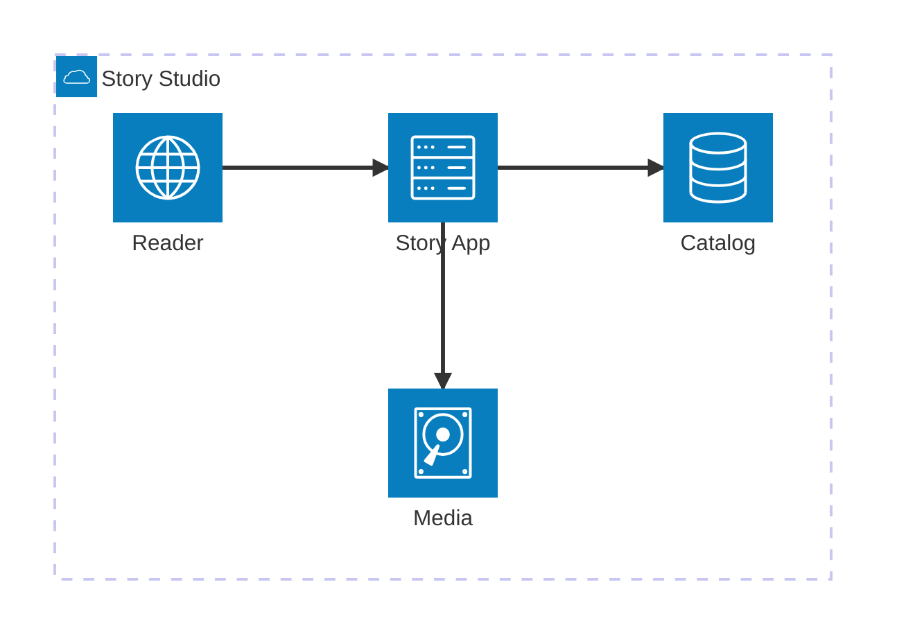

# Architecture diagram syntax

Learn the essentials of Mermaid's architecture diagram diagrams.

> Note: Mermaid marks this diagram family or syntax as experimental or beta; its syntax and rendering may change.

## Structure

Start with `architecture-beta`. Declare groups and services, optionally place services in groups, and connect service sides using direction letters.

## Considerations

The bundled renderer uses local resources. Built-in icons work without network access; external icon packs require integration that this wrapper does not provide.

Swift-Mermaid renders the diagram with its bundled Mermaid engine in strict
security mode; see <doc:SecurityAndLimits>. For the full grammar, options,
and edge cases, see the [Mermaid 12.3.0 architecture diagram reference](https://github.com/mermaid-js/mermaid/blob/mermaid%4012.3.0/packages/mermaid/src/docs/syntax/architecture.md).
