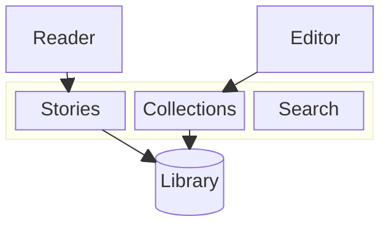

# Block diagram syntax

Learn the essentials of Mermaid's block diagram diagrams.

> Note: Mermaid marks this diagram family or syntax as experimental or beta; its syntax and rendering may change.

## Structure

Start with `block-beta`, set `columns`, and declare blocks by ID. A nested `block:ID` group ends with `end`; a width after a colon spans columns.

## Considerations

Use `space` for an empty cell and arrows between IDs for connections. Exact sizes, nesting, and layout behavior are described upstream.

Swift-Mermaid renders the diagram with its bundled Mermaid engine in strict
security mode; see <doc:SecurityAndLimits>. For the full grammar, options,
and edge cases, see the [Mermaid 12.3.0 block diagram reference](https://github.com/mermaid-js/mermaid/blob/mermaid%4012.3.0/packages/mermaid/src/docs/syntax/block.md).
