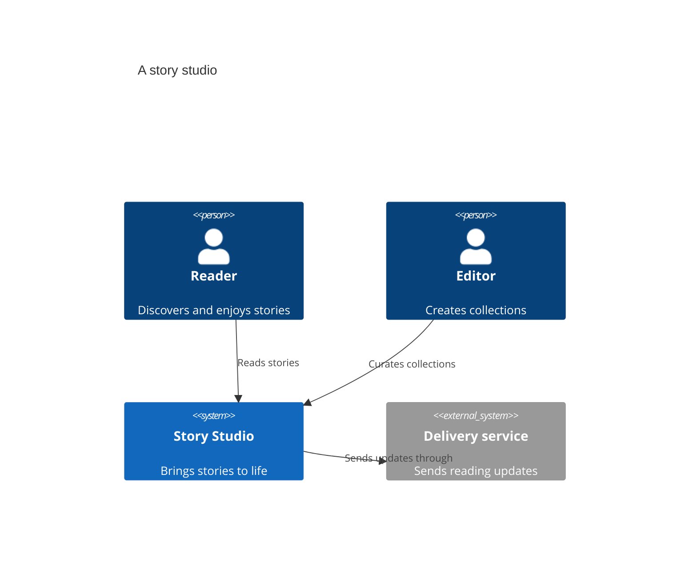

# C4 diagram syntax

Learn the essentials of Mermaid's c4 diagram diagrams.

## Structure

A `C4Context` diagram declares people and systems with `Person`, `System`, and related forms. `Rel` connects identifiers with a labeled relationship. Other C4 declarations describe different levels of detail.

## Considerations

Check the versioned reference for supported elements, boundaries, and layout controls.

Swift-Mermaid renders the diagram with its bundled Mermaid engine in strict
security mode; see <doc:SecurityAndLimits>. For the full grammar, options,
and edge cases, see the [Mermaid 12.3.0 c4 diagram reference](https://github.com/mermaid-js/mermaid/blob/mermaid%4012.3.0/packages/mermaid/src/docs/syntax/c4.md).
