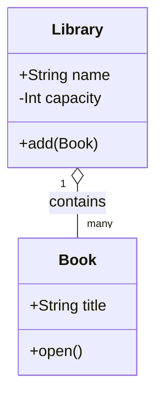
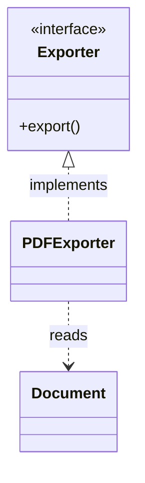
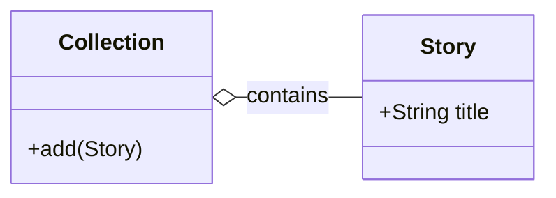

# Class diagram syntax

Describe types, their members, and relationships between them.

## Classes and members

Start with `classDiagram`. Declare classes explicitly or introduce them in a
relationship. Put members inside braces or add them with `ClassName : member`.
Use visibility prefixes such as `+` for public and `-` for private members;
parentheses mark methods.

## Relationships and annotations

Arrow symbols show different relationships: `<|--` denotes inheritance,
`*--` composition, `o--` aggregation, `-->` association, `..>` dependency,
and `..|>` realization. Reverse a relationship's orientation when needed.
Quoted endpoint labels can express multiplicity; a label after `:` describes
the relationship. `<<interface>>` and similar annotations communicate a
class's role.

Direction is set with `direction`, for example `direction LR`. Namespaces
group classes in `namespace Name { ... }`. A class can be assigned a reusable
style definition:

The Mermaid renderer draws these annotations; it doesn't verify a programming
language's type rules. Class styles use `classDef` and `cssClass` or the `:::`
shorthand, which differs from flowchart style assignment. For namespaces,
generics, member classifiers, directions, styling, and all relationship forms,
see the [Mermaid 12.3.0 class reference](https://github.com/mermaid-js/mermaid/blob/mermaid%4012.3.0/packages/mermaid/src/docs/syntax/classDiagram.md).
