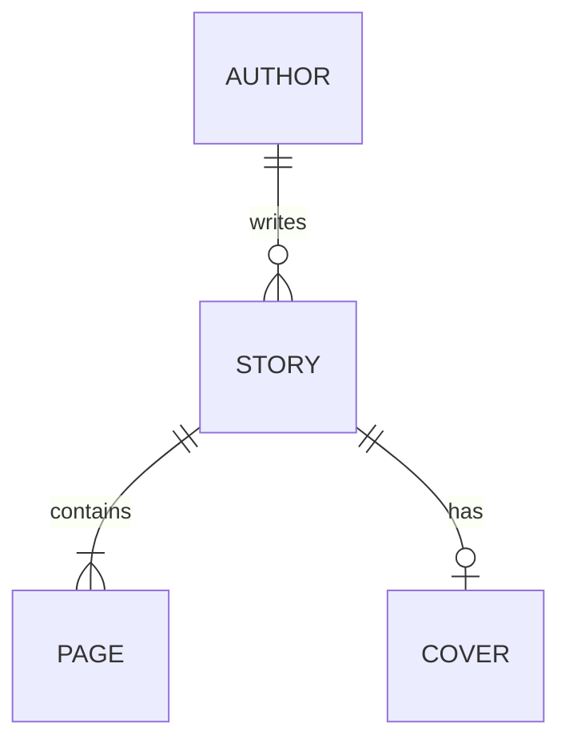
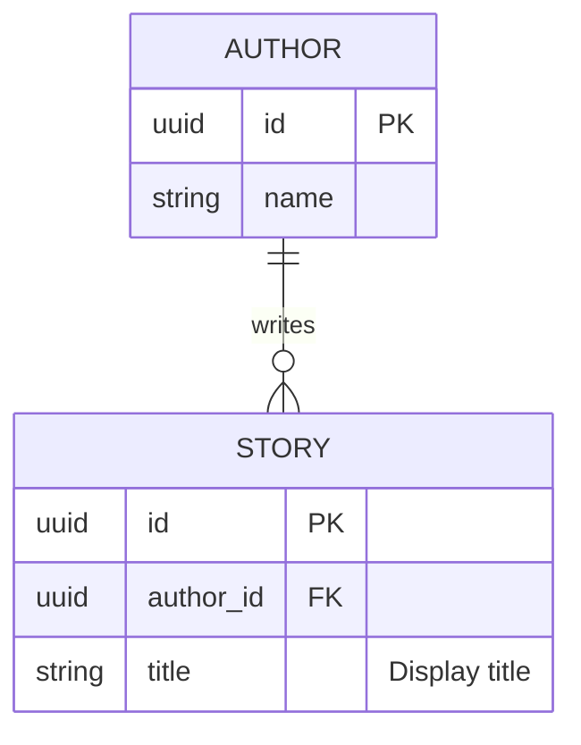

# Entity relationship diagram syntax

Describe data entities, attributes, and cardinality.

## Entities and relationships

Begin with `erDiagram`. A relationship joins two entity names with a
cardinality marker and a label after `:`. Read the endpoint marker beside each
entity as the number of instances allowed at that end.

Common endpoint markers are `||` for exactly one, `o|` for zero or one,
`o{` for zero or more, and `|{` for one or more. Their mirrored forms are used
on the other end: for example, `}o` and `}|`. A solid `--` and dashed `..`
connection distinguish identifying and non-identifying relationships in
Mermaid's notation.

## Attributes

An entity block contains attribute lines with a type and name. Optional `PK`,
`FK`, or `UK` markers identify keys, and a quoted comment can add context.
Attributes are labels: Mermaid doesn't validate a database schema.

Use `direction` where appropriate to influence layout. Mermaid also supports
entity aliases and diagram styling. Consult the
[Mermaid 12.3.0 entity relationship reference](https://github.com/mermaid-js/mermaid/blob/mermaid%4012.3.0/packages/mermaid/src/docs/syntax/entityRelationshipDiagram.md)
for the full cardinality table, attribute grammar, aliases, and styling rules.
