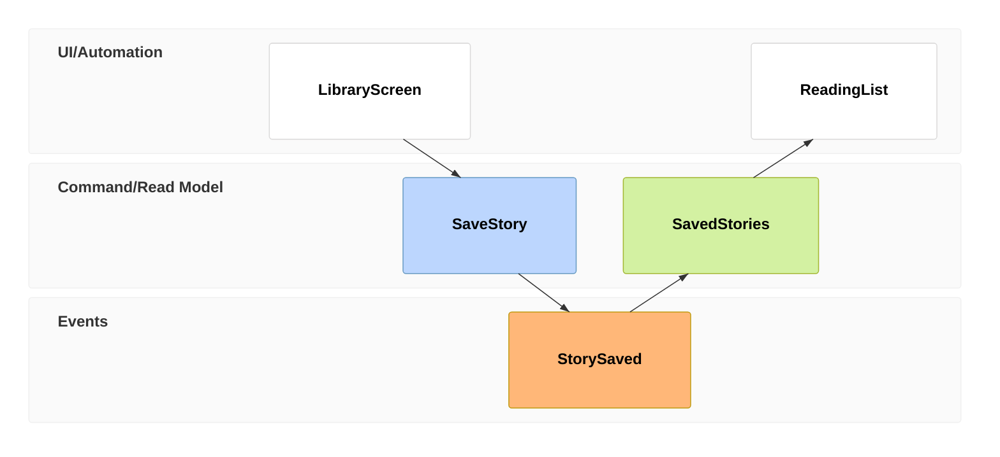

# Event modeling syntax

Learn the essentials of Mermaid's event modeling diagrams.

## Structure

Start with `eventmodeling`. A `tf` line places a named item in a time frame and identifies its kind, such as `ui`, `cmd`, `evt`, or `rmo`.

## Considerations

The diagram documents a model rather than running commands or enforcing event ordering. See the reference for processors, annotations, and layout.

Swift-Mermaid renders the diagram with its bundled Mermaid engine in strict
security mode; see <doc:SecurityAndLimits>. For the full grammar, options,
and edge cases, see the [Mermaid 12.3.0 event modeling reference](https://github.com/mermaid-js/mermaid/blob/mermaid%4012.3.0/packages/mermaid/src/docs/syntax/eventmodeling.md).
