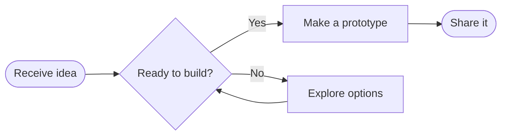
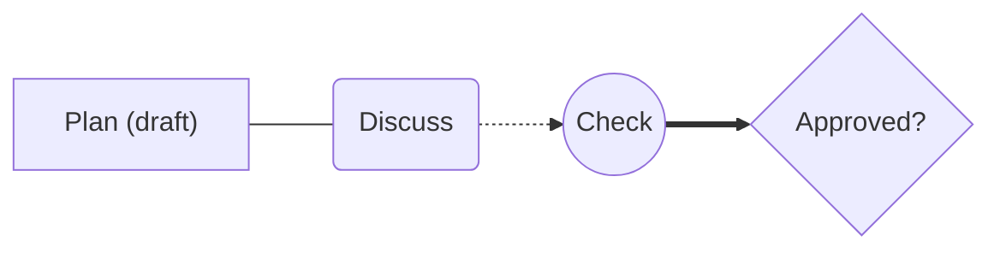
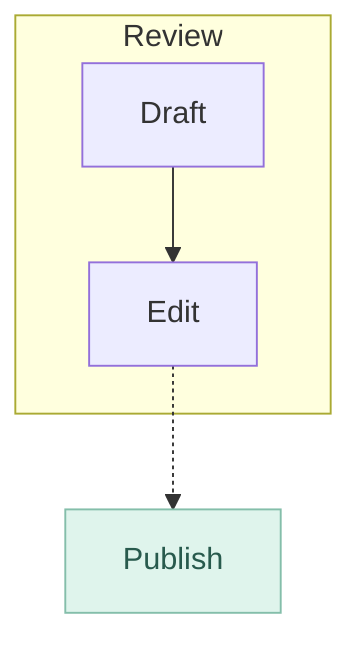

# Flowchart syntax

Describe nodes, decisions, connections, and groups in a process.

## Nodes and directions

Start with `flowchart` or `graph` and a direction: `TD` or `TB` for top to
bottom, `BT` for bottom to top, `LR` for left to right, or `RL` for right to
left. A node ID identifies a node; brackets provide its label and shape.
Repeated IDs refer to the same node.

Common shapes include rectangles `A[Label]`, rounded rectangles `A(Label)`,
stadiums `A([Label])`, circles `A((Label))`, and diamonds `A{Label}`. Quote a
label when its punctuation would otherwise be interpreted as syntax, for
example `A["Plan (draft)"]`. The upstream reference lists additional shapes.

## Links, groups, and styles

Use `-->` for an arrow, `---` for an undirected line, `-.->` for a dotted
arrow, and `==>` for a thick arrow. A label between pipes follows the link,
as in `A -->|approved| B`. A `subgraph` groups nodes; end it with `end`.
`classDef` declares styles and `class` applies a style to node IDs.

Use care with reserved words such as lowercase `end` and with identifiers
immediately following link syntax. `click` directives don't execute in this
package's strict security mode. Subgraph direction can depend on connections
to nodes outside the group. Mermaid also supports edge length hints, chaining,
multiple node declarations, link styling, and additional shapes. See the
[Mermaid 12.3.0 flowchart reference](https://github.com/mermaid-js/mermaid/blob/mermaid%4012.3.0/packages/mermaid/src/docs/syntax/flowchart.md)
for the full shape, link, styling, and layout syntax.
