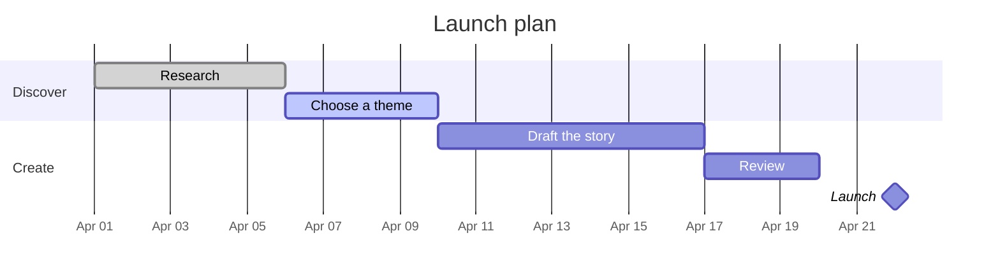
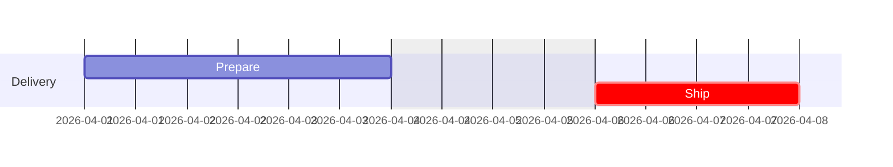

# Gantt diagram syntax

Arrange dated tasks and milestones on a timeline.

## Timeline and tasks

Start with `gantt`, then set `dateFormat` for the input dates. `axisFormat`
controls how dates are displayed on the axis. A `section` groups subsequent
tasks. Each task has a label, a colon, optional metadata, and scheduling data.

An explicit start date plus a duration such as `5d` schedules a task; a start
and an end date is another form. An ID such as `research` makes a task
available to `after research`. Metadata includes `done`, `active`, `crit`, and
`milestone`; these affect presentation rather than enforcing project rules.
The example turns off the current-day marker so snapshots remain stable.

An `excludes` line can remove weekends or specified dates when Mermaid
calculates task durations. This example also demonstrates a critical task:

## Dates, exclusions, and appearance

`dateFormat` uses Mermaid's date parsing conventions; `axisFormat` uses the
axis formatting conventions described upstream. `excludes` can omit dates or
weekdays from duration calculations. Be careful with time zones, daylight
saving changes, holidays, and dependencies when dates have operational
consequences: a chart is a visualization, not a scheduling engine contract.

For the complete grammar, `after` and `until`, exclusions, tick intervals,
vertical markers, task statuses, and configuration, consult the
[Mermaid 12.3.0 Gantt reference](https://github.com/mermaid-js/mermaid/blob/mermaid%4012.3.0/packages/mermaid/src/docs/syntax/gantt.md).
The example gallery contains a larger Gantt chart with custom colors and
spacing.
