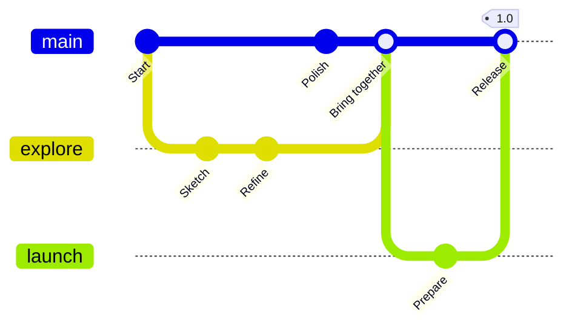

# Git graph syntax

Learn the essentials of Mermaid's git graph diagrams.

## Structure

Start with `gitGraph`, then use `commit`, `branch`, `checkout`, and `merge` to model a history. Optional commit IDs and tags supply readable labels.

## Considerations

The diagram is illustrative: it does not inspect a repository or execute Git commands. Branch names and merge positions affect the layout.

Swift-Mermaid renders the diagram with its bundled Mermaid engine in strict
security mode; see <doc:SecurityAndLimits>. For the full grammar, options,
and edge cases, see the [Mermaid 12.3.0 git graph reference](https://github.com/mermaid-js/mermaid/blob/mermaid%4012.3.0/packages/mermaid/src/docs/syntax/gitgraph.md).
