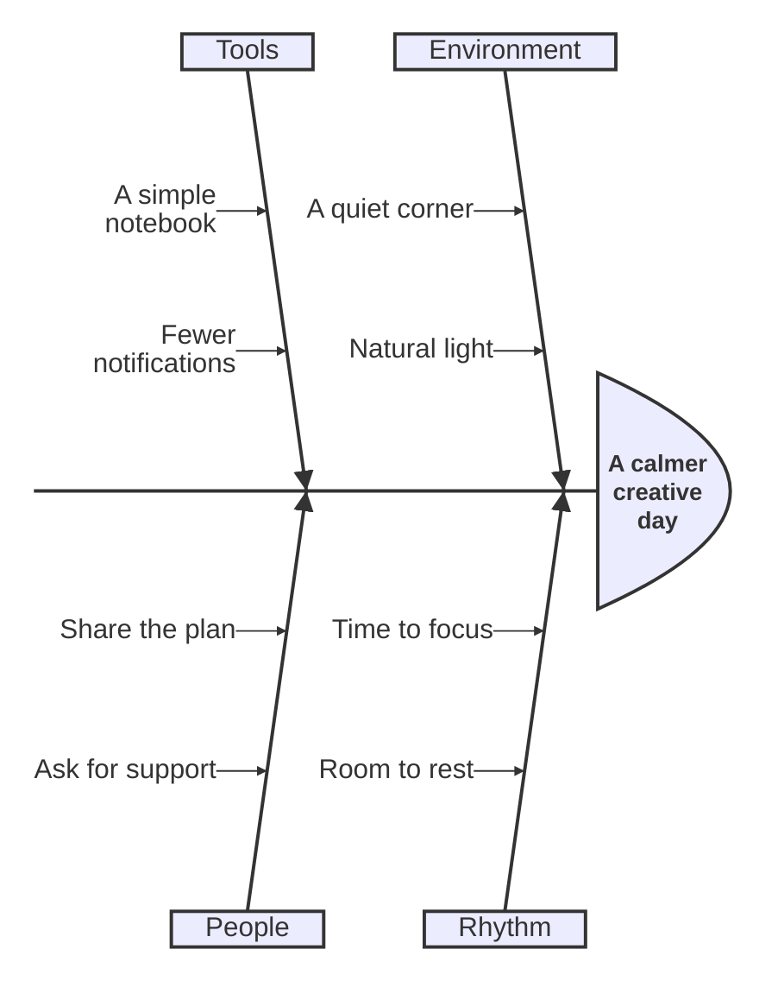

# Ishikawa diagram syntax

Learn the essentials of Mermaid's ishikawa diagram diagrams.

> Note: Mermaid marks this diagram family or syntax as experimental or beta; its syntax and rendering may change.

## Structure

Start with `ishikawa-beta`. The first indented item is the subject; further indentation describes categories and their nested causes or contributing factors.

## Considerations

A branch records a possible relationship. Investigate and validate causes rather than assuming the diagram proves them.

Swift-Mermaid renders the diagram with its bundled Mermaid engine in strict
security mode; see <doc:SecurityAndLimits>. For the full grammar, options,
and edge cases, see the [Mermaid 12.3.0 ishikawa diagram reference](https://github.com/mermaid-js/mermaid/blob/mermaid%4012.3.0/packages/mermaid/src/docs/syntax/ishikawa.md).
