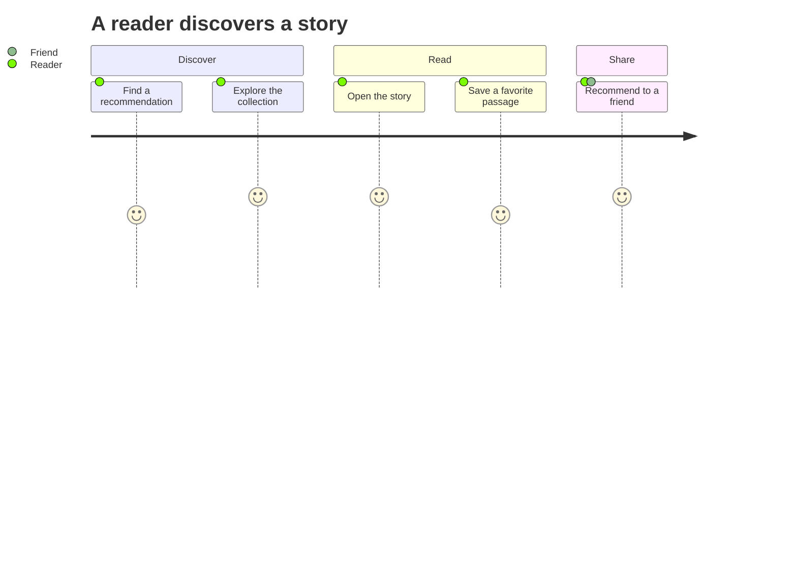

# User journey syntax

Learn the essentials of Mermaid's user journey diagrams.

## Structure

Start with `journey`, optionally add a `title`, and group tasks using `section`. Each task has a label, a score, and one or more comma-separated actors after colons.

## Considerations

The scores communicate experience rather than a measured duration. Choose meaningful labels and keep scores within Mermaid’s supported range.

Swift-Mermaid renders the diagram with its bundled Mermaid engine in strict
security mode; see <doc:SecurityAndLimits>. For the full grammar, options,
and edge cases, see the [Mermaid 12.3.0 user journey reference](https://github.com/mermaid-js/mermaid/blob/mermaid%4012.3.0/packages/mermaid/src/docs/syntax/userJourney.md).
