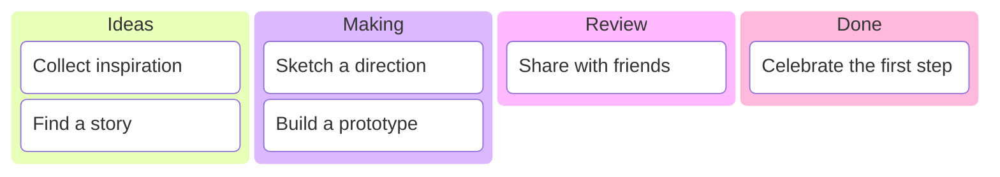

# Kanban board syntax

Learn the essentials of Mermaid's kanban board diagrams.

## Structure

Start with `kanban`. Indent task nodes below their column nodes; each node can have an identifier and a display label in brackets.

## Considerations

This is a static diagram, not an interactive task tracker. Consult the reference for metadata, assigned users, and priorities.

Swift-Mermaid renders the diagram with its bundled Mermaid engine in strict
security mode; see <doc:SecurityAndLimits>. For the full grammar, options,
and edge cases, see the [Mermaid 12.3.0 kanban board reference](https://github.com/mermaid-js/mermaid/blob/mermaid%4012.3.0/packages/mermaid/src/docs/syntax/kanban.md).
