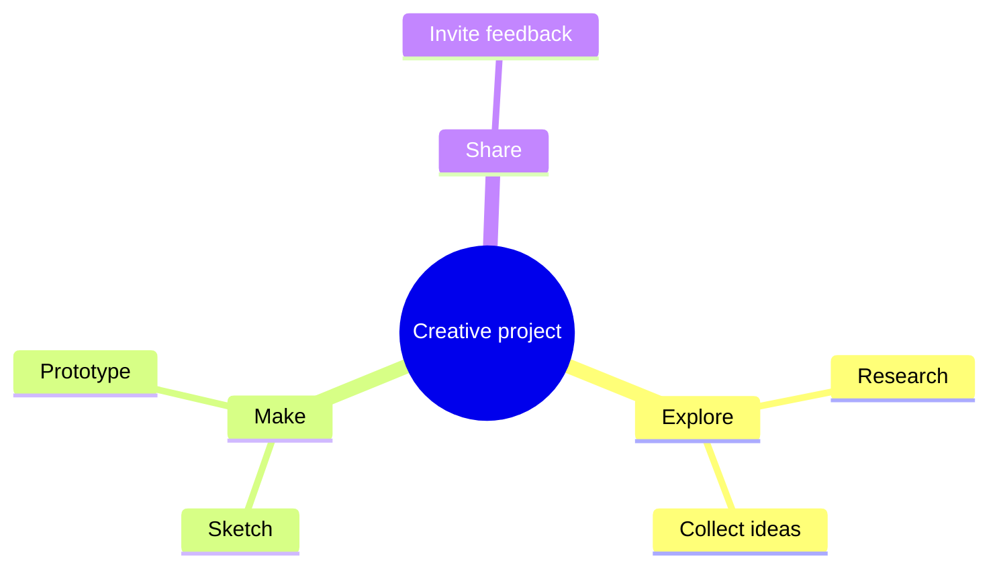
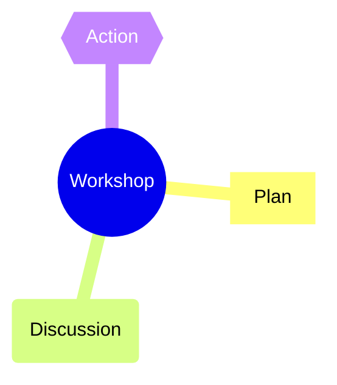

# Mindmap syntax

Organize ideas as an indented hierarchy.

## Hierarchy and shapes

Start with `mindmap`, then add a root and indent its children. Siblings use the
same indentation; a deeper indentation creates a child of the preceding node.
Node IDs can be followed by shape delimiters containing a display label.

Common forms include `id[Square]`, `id(Rounded)`, `id((Circle))`,
`id))Bang((`, `id)Cloud(`, and `id{{Hexagon}}`. A bare text line also creates
a node. Keep indentation consistent and use one root for a connected map.

## Styling and icons

A line beginning with `:::` can assign a CSS class to the preceding node;
`::icon(...)` can attach an icon when the required icon resources are
available. Swift-Mermaid's local rendering page doesn't fetch remote resources,
so don't assume externally hosted fonts or icons will load. Colors depend on
the selected theme and Mermaid's mindmap configuration.

See the [Mermaid 12.3.0 mindmap reference](https://github.com/mermaid-js/mermaid/blob/mermaid%4012.3.0/packages/mermaid/src/docs/syntax/mindmap.md)
for supported shapes, icon and class syntax, and configuration.
