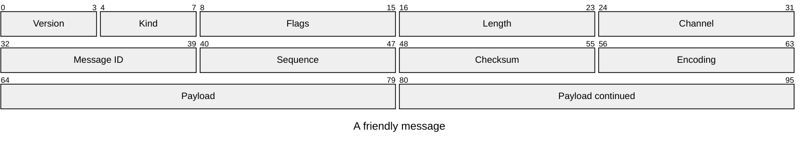

# Packet diagram syntax

Learn the essentials of Mermaid's packet diagram diagrams.

> Note: Mermaid marks this diagram family or syntax as experimental or beta; its syntax and rendering may change.

## Structure

Start with `packet-beta`. Each line maps a bit or an inclusive bit range to a quoted field label. Mermaid lays out the fields in rows.

## Considerations

Declare ranges in ascending order and avoid overlaps. Use packet configuration such as `bitsPerRow` when a different row width makes a format clearer.

Swift-Mermaid renders the diagram with its bundled Mermaid engine in strict
security mode; see <doc:SecurityAndLimits>. For the full grammar, options,
and edge cases, see the [Mermaid 12.3.0 packet diagram reference](https://github.com/mermaid-js/mermaid/blob/mermaid%4012.3.0/packages/mermaid/src/docs/syntax/packet.md).
