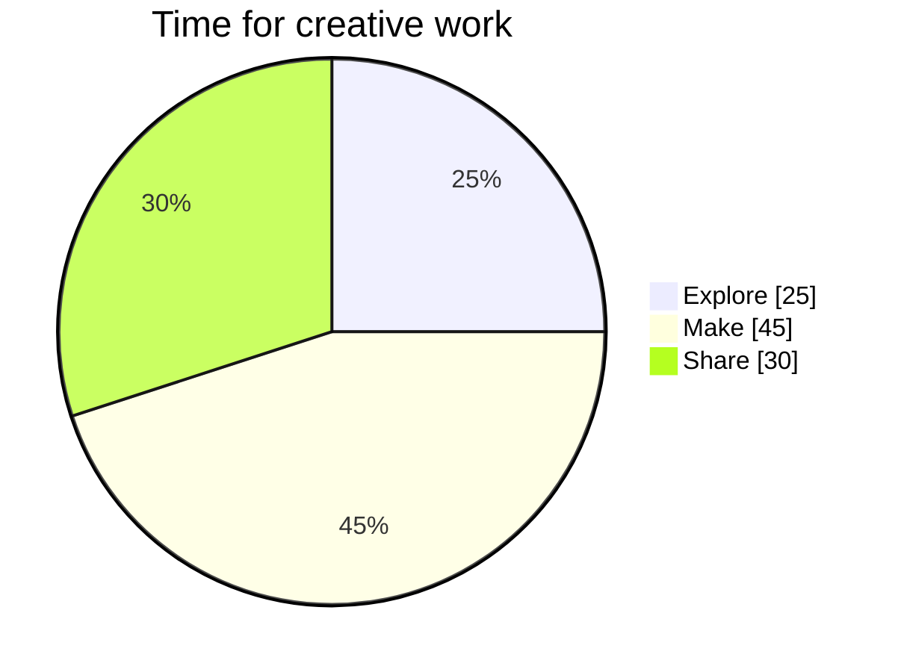

# Pie chart syntax

Visualize named numeric values as portions of a whole.

## Labels and values

Begin with `pie`. An optional `title` supplies a heading, and `showData` asks
Mermaid to include values in the legend. Each data line has a quoted label, a
colon, and a number. Mermaid calculates proportions from the values; they
don't have to add up to 100.

Keep labels distinct and provide meaningful, nonnegative values with a
positive total. These are authoring recommendations; they aren't additional
validation performed by Swift-Mermaid. Use an accompanying text description or
table when a reader needs exact values or can't distinguish the colors.

## Styling and interpretation

A pie chart is best suited to a small number of categories that represent the
same whole. Theme variables can change the slice palette; the built-in
``MermaidTheme`` values apply to the whole diagram. The gallery includes a
custom pastel palette.

See the [Mermaid 12.3.0 pie reference](https://github.com/mermaid-js/mermaid/blob/mermaid%4012.3.0/packages/mermaid/src/docs/syntax/pie.md)
for syntax, configuration, and formatting details.
