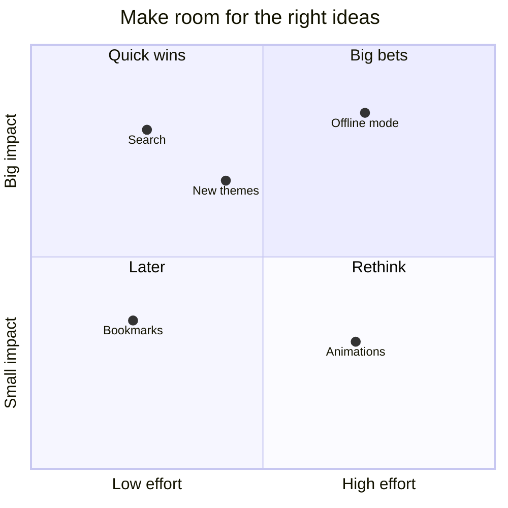

# Quadrant chart syntax

Learn the essentials of Mermaid's quadrant chart diagrams.

## Structure

Start with `quadrantChart`. Name each axis with `x-axis` and `y-axis`, label the quadrants, and place points using `Label: [x, y]` coordinates.

## Considerations

Coordinates are normalized from 0 to 1. Explain what the axes measure so the point positions can be interpreted.

Swift-Mermaid renders the diagram with its bundled Mermaid engine in strict
security mode; see <doc:SecurityAndLimits>. For the full grammar, options,
and edge cases, see the [Mermaid 12.3.0 quadrant chart reference](https://github.com/mermaid-js/mermaid/blob/mermaid%4012.3.0/packages/mermaid/src/docs/syntax/quadrantChart.md).
