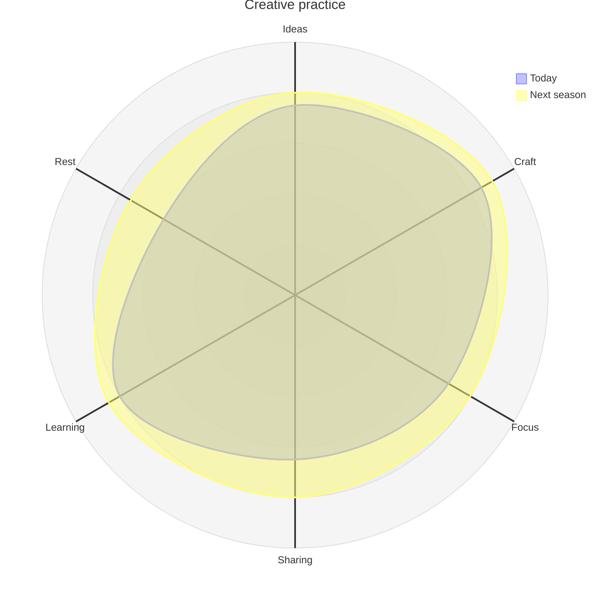

# Radar chart syntax

Learn the essentials of Mermaid's radar chart diagrams.

> Note: Mermaid marks this diagram family or syntax as experimental or beta; its syntax and rendering may change.

## Structure

Start with `radar-beta`, declare axes with IDs and labels, and provide a curve with one numeric value per axis. Optional `min` and `max` establish the range.

## Considerations

Use comparable scales and explain units; an attractive polygon alone does not indicate overall quality.

Swift-Mermaid renders the diagram with its bundled Mermaid engine in strict
security mode; see <doc:SecurityAndLimits>. For the full grammar, options,
and edge cases, see the [Mermaid 12.3.0 radar chart reference](https://github.com/mermaid-js/mermaid/blob/mermaid%4012.3.0/packages/mermaid/src/docs/syntax/radar.md).
