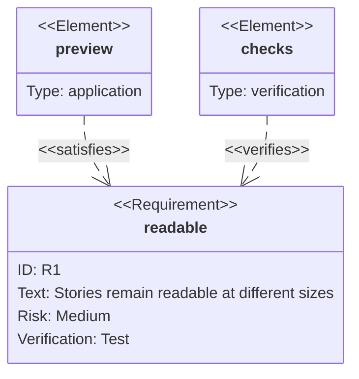

# Requirement diagram syntax

Learn the essentials of Mermaid's requirement diagram diagrams.

## Structure

Use `requirementDiagram`, then declare `requirement` and `element` blocks. Requirements can contain an ID, descriptive text, risk, and verification method. Connect elements and requirements with named relationships.

## Considerations

Relationship arrows describe traceability; Mermaid does not verify that an implementation actually satisfies a requirement.

Swift-Mermaid renders the diagram with its bundled Mermaid engine in strict
security mode; see <doc:SecurityAndLimits>. For the full grammar, options,
and edge cases, see the [Mermaid 12.3.0 requirement diagram reference](https://github.com/mermaid-js/mermaid/blob/mermaid%4012.3.0/packages/mermaid/src/docs/syntax/requirementDiagram.md).
