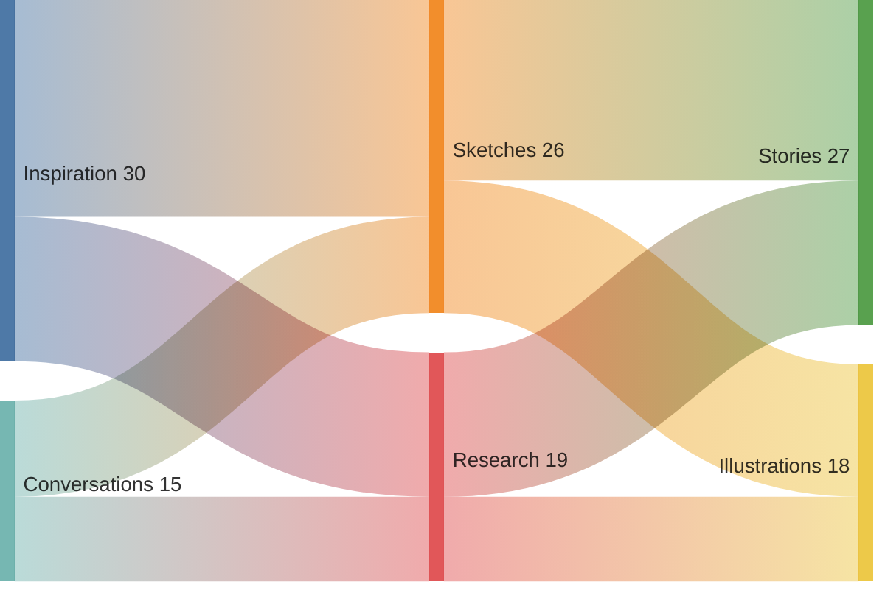

# Sankey diagram syntax

Learn the essentials of Mermaid's sankey diagram diagrams.

> Note: Mermaid marks this diagram family or syntax as experimental or beta; its syntax and rendering may change.

## Structure

Start with `sankey-beta`. Each subsequent data row contains a source, target, and numeric value separated by commas. Reusing a node name joins the corresponding flows.

## Considerations

Use consistent units and nonnegative values. Labels containing commas require CSV quoting; see the upstream reference for formatting and configuration.

Swift-Mermaid renders the diagram with its bundled Mermaid engine in strict
security mode; see <doc:SecurityAndLimits>. For the full grammar, options,
and edge cases, see the [Mermaid 12.3.0 sankey diagram reference](https://github.com/mermaid-js/mermaid/blob/mermaid%4012.3.0/packages/mermaid/src/docs/syntax/sankey.md).
