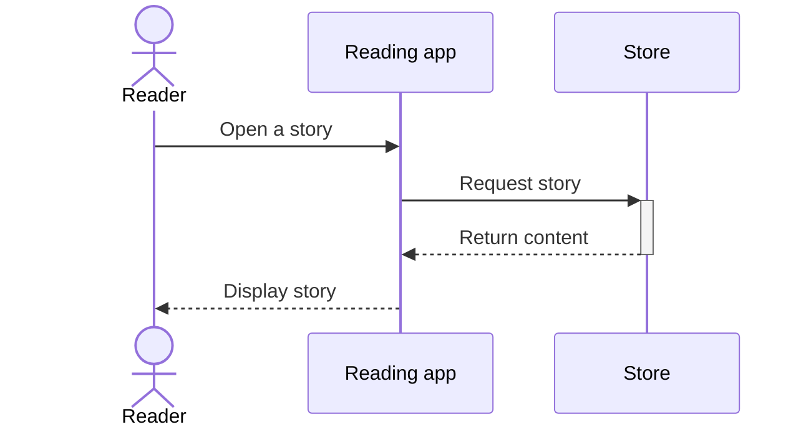
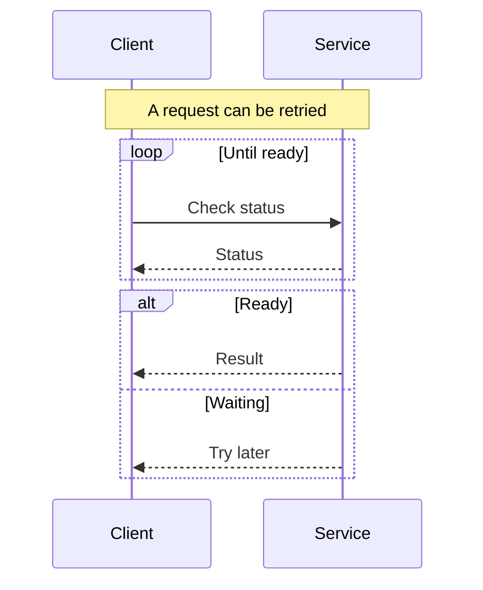

# Sequence diagram syntax

Show messages exchanged by participants in time order.

## Participants and messages

Begin with `sequenceDiagram`. Declare `participant` or `actor` entries to
control ordering; `as` supplies a display name. Undeclared participants can
also be introduced by a message. Each message specifies sender, arrow,
receiver, a colon, and text.

`->>` draws a solid arrowhead and `-->>` a dashed one. Other arrow forms
represent different message styles. The `+` and `-` suffixes on the receiver
activate and deactivate its lifeline; `activate` and `deactivate` are explicit
alternatives. These are diagram annotations, not executable calls.

## Notes and control flow

`Note over`, `Note left of`, and `Note right of` add explanatory text. Use
`loop` for repetition, `alt` and `else` for alternatives, `opt` for an optional
section, and `par` and `and` for parallel sections. Close each block with `end`.

For the full set of arrows, participant lifecycle statements, grouping,
configuration, and parser constraints, see the
[Mermaid 12.3.0 sequence reference](https://github.com/mermaid-js/mermaid/blob/mermaid%4012.3.0/packages/mermaid/src/docs/syntax/sequenceDiagram.md).
