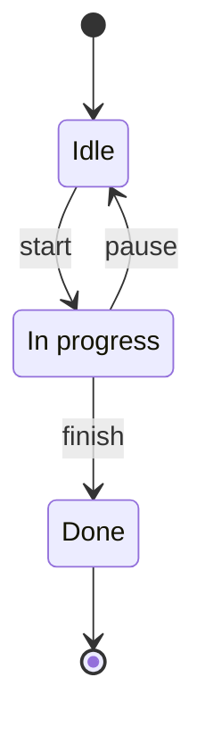
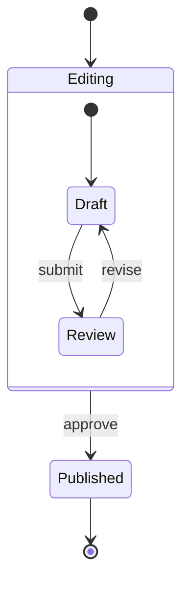
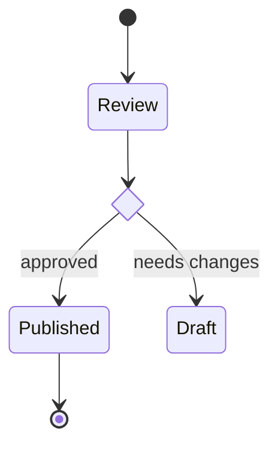

# State diagram syntax

Model states, transitions, and nested state machines.

## States and transitions

Start with `stateDiagram-v2`. A transition uses `-->`; add a label after a
colon. `[*]` represents the start or end, depending on its position in a
transition. Declare an alias with `state "display name" as ID` when an ID
isn't suitable as a label.

## Composite states and choices

A `state Name { ... }` block defines a composite state with its own transitions.
Use `<<choice>>`, `<<fork>>`, or `<<join>>` to mark special transition nodes.
`direction LR` or `direction TB` controls layout where supported. Notes and
concurrent regions provide further ways to describe the model.

To model a decision, declare a named choice and connect labeled transitions to
it. Choice and fork nodes are diagram constructs; application code must still
implement the actual conditions and concurrency.

Style ordinary states with `classDef` and `class`, subject to Mermaid's
limitations for composite states and start/end markers. For notes, concurrent
regions, choice, fork, join, and exact restrictions, consult the
[Mermaid 12.3.0 state reference](https://github.com/mermaid-js/mermaid/blob/mermaid%4012.3.0/packages/mermaid/src/docs/syntax/stateDiagram.md).
