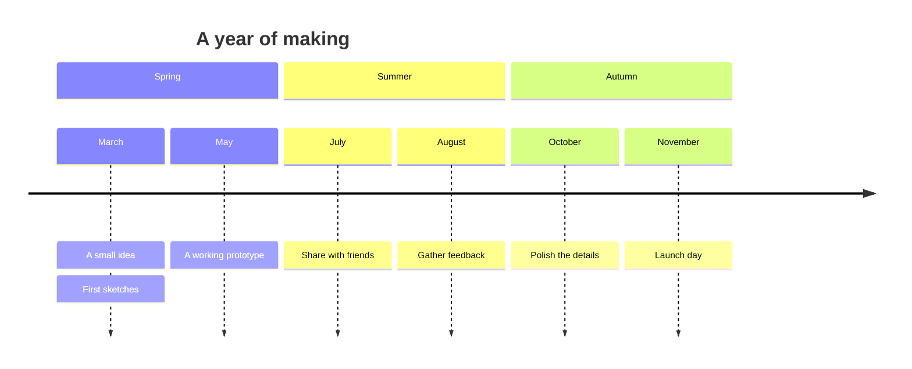

# Timeline syntax

Learn the essentials of Mermaid's timeline diagrams.

## Structure

Start with `timeline`, add an optional title, and write a period followed by colon-separated events. A `section` groups related periods.

## Considerations

Timeline positions describe an ordered narrative rather than a precise duration scale. Use a Gantt chart for tasks with dates and durations.

Swift-Mermaid renders the diagram with its bundled Mermaid engine in strict
security mode; see <doc:SecurityAndLimits>. For the full grammar, options,
and edge cases, see the [Mermaid 12.3.0 timeline reference](https://github.com/mermaid-js/mermaid/blob/mermaid%4012.3.0/packages/mermaid/src/docs/syntax/timeline.md).
