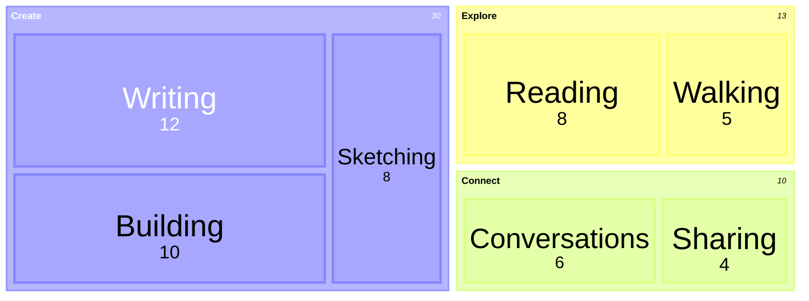

# Treemap syntax

Learn the essentials of Mermaid's treemap diagrams.

> Note: Mermaid marks this diagram family or syntax as experimental or beta; its syntax and rendering may change.

## Structure

Start with `treemap-beta` and indent categories and leaves to express hierarchy. Leaf labels are followed by numeric values.

## Considerations

Areas visualize relative values. Use a consistent unit and provide text alternatives when exact values matter.

Swift-Mermaid renders the diagram with its bundled Mermaid engine in strict
security mode; see <doc:SecurityAndLimits>. For the full grammar, options,
and edge cases, see the [Mermaid 12.3.0 treemap reference](https://github.com/mermaid-js/mermaid/blob/mermaid%4012.3.0/packages/mermaid/src/docs/syntax/treemap.md).
