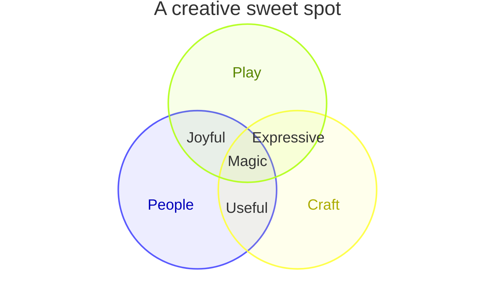

# Venn diagram syntax

Learn the essentials of Mermaid's venn diagram diagrams.

> Note: Mermaid marks this diagram family or syntax as experimental or beta; its syntax and rendering may change.

## Structure

Start with `venn-beta`, declare named sets, and use `union` lines to label shared regions. Optional size values and styles are described upstream.

## Considerations

The visual overlap is a diagram of relationships and should not be treated as statistically exact without validating its inputs and layout.

Swift-Mermaid renders the diagram with its bundled Mermaid engine in strict
security mode; see <doc:SecurityAndLimits>. For the full grammar, options,
and edge cases, see the [Mermaid 12.3.0 venn diagram reference](https://github.com/mermaid-js/mermaid/blob/mermaid%4012.3.0/packages/mermaid/src/docs/syntax/venn.md).
