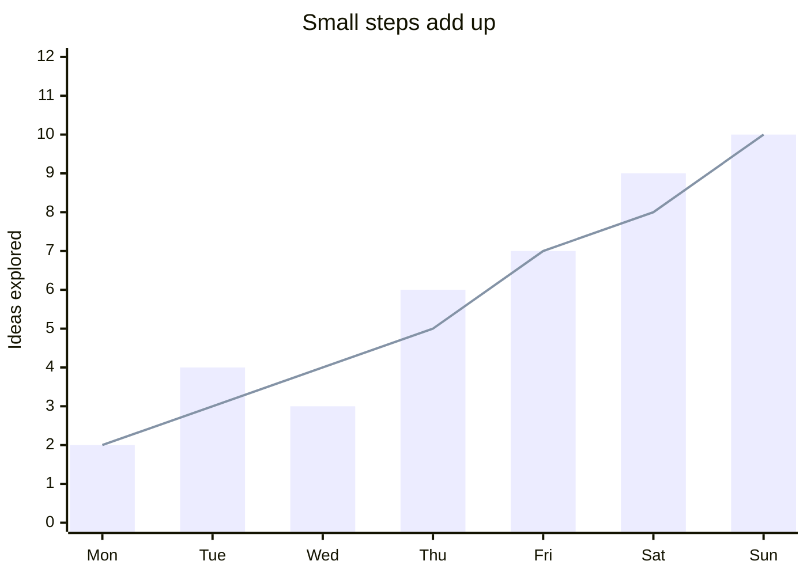

# XY chart syntax

Learn the essentials of Mermaid's xy chart diagrams.

> Note: Mermaid marks this diagram family or syntax as experimental or beta; its syntax and rendering may change.

## Structure

Start with `xychart-beta`. Give the x-axis categories or a numeric range, specify the y-axis range, and add `bar` or `line` series.

## Considerations

Series values must correspond to the axis categories. The chart draws supplied data and does not derive statistical conclusions.

Swift-Mermaid renders the diagram with its bundled Mermaid engine in strict
security mode; see <doc:SecurityAndLimits>. For the full grammar, options,
and edge cases, see the [Mermaid 12.3.0 xy chart reference](https://github.com/mermaid-js/mermaid/blob/mermaid%4012.3.0/packages/mermaid/src/docs/syntax/xyChart.md).
